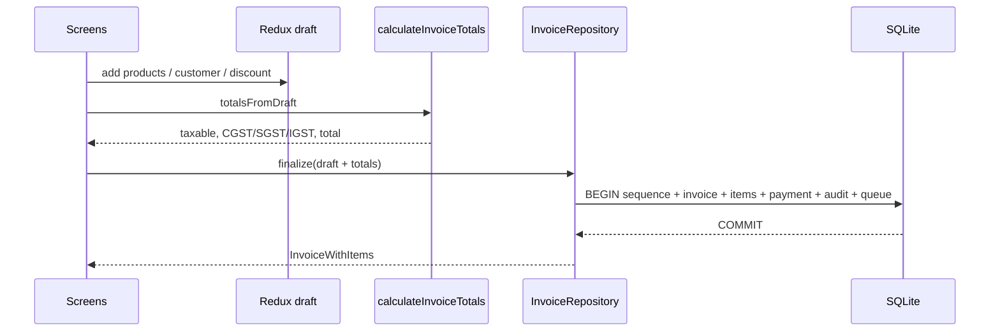

# GST Invoice — Admin Guide

This guide is for shop owners who configure the business, and for operators/developers who run or extend the system.

It covers **admin workflows**, the **local data APIs** (v1), the **GST engine API**, and the **planned cloud REST / sync APIs**.

Related docs: [User Guide](./USER_GUIDE.md) · [Architecture](./ARCHITECTURE.md) · [Data Model](./DATA_MODEL.md) · [Sync](./SYNC.md)

---

## 1. Role of “admin” in this product

There is **no admin website** and **no login** in v1. One device holds one shop.

| Role | Where they work | What they control |
|---|---|---|
| Shop admin | **Settings** tab + catalog | Business profile, GST registration, invoice prefix, products, customers |
| System admin / developer | Device + monorepo | SQLite ledger, repositories, GST engine, future NestJS APIs |

v1 is local-first. SQLite (`invoice-gst.db`) is the source of truth. Network APIs are specified for a later phase and are **not called** from billing.

---

## 2. System overview

```
GST Invoice app (Expo / React Native)
        │
        ├── Screens (UI only)
        ├── Redux  → current invoice draft only
        ├── Repositories → SQLite (Drizzle + expo-sqlite)
        └── packages/shared → GST math, FY, money
```

| Layer | Responsibility |
|---|---|
| Screens | Input, navigation, alerts |
| Redux `invoiceDraft` | Unsaved invoice until finalize |
| Repositories | Persist vendors, products, customers, invoices |
| `calculateInvoiceTotals` | Tax math (integers only) |
| Zod (`packages/validation`) | Form rules before write |
| `sync_queue` | Outbox rows for a future backend; no worker yet |

---

## 3. Admin workflows

### 3.1 Shop profile (required)

Path: **Settings → Save profile**

| Field | Rule | Effect |
|---|---|---|
| Business name | Required | Shown on Home |
| GSTIN | Empty or valid 15-char GSTIN | Stored on vendor; not rewritten onto old invoices |
| State code | 2-digit GST code | Place of supply and intra/inter-state |
| Invoice prefix | 1–12 alphanumeric | Part of `PREFIX/FY/000001` |
| GST registration | `regular` \| `composition` \| `unregistered` | Composition flips `gst_configurations.compositionScheme` |

On first create, the app also inserts GST config:

| GST config default | Value |
|---|---|
| `defaultGstRateBps` | `1800` (18%) |
| `enableIgst` | `true` |
| `roundingMode` | `nearest` |
| `compositionScheme` | `true` only if registration is `composition` |

There is no Settings UI yet for rounding mode or default GST rate. Those live in SQLite and are used at finalize.

**State codes in the UI:** 32 Kerala, 33 Tamil Nadu, 29 Karnataka, 36 Telangana, 37 Andhra Pradesh, 27 Maharashtra, 07 Delhi, 24 Gujarat, 09 Uttar Pradesh, 19 West Bengal.

### 3.2 Catalog administration

- Products are soft-deletable in the repository (`deletedAt`). The current UI does not expose delete.
- Editing a product does **not** change finalized invoice lines (snapshots).
- Aliases are first-class. **Add in words** on a new invoice matches them. Normalize on write: trim, split on comma.
- SKU uniqueness is not enforced by SQLite in v1; enforce in the repository if you add a second SKU.

### 3.3 Customer administration

- `customerType` in the schema: `b2c` \| `b2b` \| `unregistered`. The form defaults to `b2c`; there is no type picker in the current UI.
- Missing `stateCode` → intra-state (shop state).
- Soft delete exists on the repository; not in the UI.

### 3.4 Invoice administration

| Action | Allowed | How |
|---|---|---|
| Create / finalize | Yes | Preview → Save |
| Edit finalized | **No** | Immutable |
| Cancel | Once | Invoice details → Cancel invoice |
| Reuse number | **No** | Sequence already consumed |
| Credit note | **No** | Out of v1 |

Cancel writes `status = cancelled`, an `audit_events` row (`action = cancelled`), and a `sync_queue` row (`operation = update`).

### 3.5 First-run seed

If no vendor exists:

1. Vendor `My Shop`, state `32`, type `regular`, prefix `INV`
2. Product Rice / Ari, HSN `1006`, ₹50.00/kg exclusive, 5% GST

Idempotent: skipped when a vendor row already exists.

### 3.6 Device operations

| Task | Notes |
|---|---|
| Database file | `invoice-gst.db` via Expo SQLite |
| Migrations | Applied on launch (`PRAGMA foreign_keys = ON`) |
| Wipe data | Uninstall the app or clear app data |
| Backup | Copy the SQLite file; no cloud backup in v1 |
| Secrets | None required. Do not commit `.env` |

---

## 4. Local data APIs (implemented)

These are the v1 “APIs”: TypeScript repositories. Screens must not open a raw `db` handle.

Factory: `createRepositories(db)` in `apps/mobile/src/database/repositories`.

### 4.1 VendorRepository

```
get() → Vendor | null
getGstConfig(vendorId) → GstConfiguration | null
upsert(input) → Vendor
```

**`upsert`**

- If a vendor exists: update profile; set `gst_configurations.compositionScheme` from `gstRegistrationType`.
- If none: insert vendor + GST config (defaults above).
- Always sets `syncStatus = pending`.

**Vendor input**

```ts
{
  businessName: string;
  tradeName: string | null;
  gstin: string | null;
  phone: string | null;
  email: string | null;
  addressLine1: string | null;
  addressLine2: string | null;
  city: string | null;
  stateCode: string;          // 2-digit
  pincode: string | null;
  gstRegistrationType: 'regular' | 'composition' | 'unregistered';
  invoicePrefix: string;
  logoUri?: string | null;
}
```

### 4.2 ProductRepository

```
listActive() → Product[]          // deletedAt IS NULL AND isActive = 1
list() → Product[]                // deletedAt IS NULL
get(id) → Product | null
create(input) → Product
update(id, input) → Product
softDelete(id) → void             // deletedAt, isActive = 0
```

**Product input**

```ts
{
  name: string;
  localName: string | null;
  aliases: string[];
  sku: string | null;
  hsnCode: string | null;
  unit: 'kg' | 'g' | 'l' | 'ml' | 'pcs' | 'packet' | 'other';
  sellingPricePaise: number;      // integer paise
  gstRateBps: number;             // 0, 500, 1200, 1800, 2800
  priceInclusive: boolean;
  isActive: boolean;
}
```

### 4.3 CustomerRepository

```
list() → Customer[]
get(id) → Customer | null
create(input) → Customer
update(id, input) → Customer
softDelete(id) → void
```

**Customer input**

```ts
{
  name: string;
  phone: string | null;
  email: string | null;
  addressLine1: string | null;
  city: string | null;
  stateCode: string | null;
  pincode: string | null;
  gstin: string | null;
  customerType: 'b2c' | 'b2b' | 'unregistered';
}
```

### 4.4 InvoiceRepository

```
list() → Invoice[]
getWithItems(id) → InvoiceWithItems | null
finalize(input) → InvoiceWithItems
cancel(id) → void
```

**`finalize` — single SQLite transaction**

```
BEGIN
  allocate invoice_sequences.nextNumber for (vendorId, FY)
  insert invoices (status = finalized, syncStatus = pending)
  insert invoice_items[] (product snapshots)
  optional insert payments
  insert audit_events (action = finalized)
  insert sync_queue (entityType = invoice, operation = create)
COMMIT
```

If the transaction rolls back, the sequence is **not** consumed.

**`FinalizeInvoiceInput`**

```ts
{
  vendorId: string;
  prefix: string;
  invoice: {
    financialYear: string;                 // e.g. "25-26"
    customerId: string | null;
    customerSnapshot: {
      name: string;
      phone: string | null;
      gstin: string | null;
      stateCode: string | null;
    };
    placeOfSupplyStateCode: string;
    isInterState: boolean;
    subtotalPaise: number;
    discountPaise: number;
    taxablePaise: number;
    cgstPaise: number;
    sgstPaise: number;
    igstPaise: number;
    roundOffPaise: number;
    totalPaise: number;
    paymentStatus: 'unpaid' | 'partial' | 'paid';
    notes: string | null;
  };
  items: Array<{
    productId: string | null;
    productNameSnapshot: string;
    localNameSnapshot: string | null;
    hsnSnapshot: string | null;
    unitSnapshot: string;
    quantityMilli: number;
    unitPricePaise: number;
    gstRateBps: number;
    priceInclusive: boolean;
    taxablePaise: number;
    cgstPaise: number;
    sgstPaise: number;
    igstPaise: number;
    lineTotalPaise: number;
  }>;
  payment?: {
    method: 'cash' | 'upi' | 'card' | 'credit';
    amountPaise: number;
    reference?: string | null;
  };
}
```

**`cancel` errors (`InvoiceStateError`)**

| Condition | Message |
|---|---|
| Missing id | Invoice not found |
| Already cancelled | Invoice is already cancelled |
| Not finalized | Only finalized invoices can be cancelled |

### 4.5 Draft / UI API (Redux)

Slice: `invoiceDraft`. Not persisted. Reset on “New invoice” and after successful finalize.

| Action | Effect |
|---|---|
| `resetDraft` | Walk-in, no lines, discount 0, collect payment cash |
| `setWalkIn` | `customerId = null`, snapshot name `Walk-in` |
| `setCustomer` | Bind customer + snapshot |
| `addProductLine` | New line qty 1.000, or +1.000 if product already on draft |
| `setLineQuantity` | Minimum 1 milli-unit |
| `removeLine` | Drop line by key |
| `setDiscountPaise` | Invoice-level discount ≥ 0 |
| `setNotes` / `setPaymentMethod` / `setCollectPayment` | Present; payment method UI not shown |

Current Preview always sends `payment: { method: cash, amountPaise: total }` because `collectPayment` defaults to `true`.

---

## 5. GST engine API (implemented)

Package: `@invoice-gst/shared`  
Function: `calculateInvoiceTotals(input): InvoiceTotals`  
Pure. No React, SQLite, or network.

### 5.1 Input

```ts
calculateInvoiceTotals({
  lines: Array<{
    quantityMilli: number;      // 2500 = 2.500
    unitPricePaise: number;     // 5000 = ₹50.00
    gstRateBps: number;         // 1800 = 18%
    priceInclusive: boolean;
    lineDiscountPaise: number;
  }>;
  invoiceDiscountPaise: number;
  isInterState: boolean;
  roundingMode: 'nearest' | 'up' | 'down';
  compositionScheme: boolean;
})
```

### 5.2 Output

```ts
{
  subtotalPaise: number;
  discountPaise: number;
  taxablePaise: number;
  cgstPaise: number;
  sgstPaise: number;
  igstPaise: number;
  roundOffPaise: number;        // totalPaise - raw tax-inclusive total
  totalPaise: number;           // rounded to rupee
  lines: Array<{
    taxablePaise: number;
    cgstPaise: number;
    sgstPaise: number;
    igstPaise: number;
    lineTotalPaise: number;
  }>;
}
```

### 5.3 Rules

1. Line gross = `quantityMilli × unitPricePaise / 1000` (nearest).
2. Line net = max(0, gross − line discount).
3. Inclusive + GST > 0: taxable = net × 10000 / (10000 + rateBps).
4. Exclusive or 0%: taxable = net (before invoice discount).
5. Invoice discount is capped at sum of pre-discount taxables and allocated by weight (largest remainder).
6. Composition: no tax split; line total = taxable.
7. Inter-state: IGST only.
8. Intra-state: tax split; CGST = floor(tax/2), SGST = remainder (odd paise goes to SGST).
9. Invoice total rounded to rupee by `roundingMode`.

### 5.4 Place of supply

```ts
resolvePlaceOfSupply(vendorStateCode, customerStateCode)
→ { placeOfSupplyStateCode, isInterState }
```

- Missing/empty customer state → shop state, `isInterState = false`.
- Else place of supply = customer state; inter-state when codes differ.

### 5.5 Invoice numbering helpers

```ts
getFinancialYear(date?)        // IST, April–March → "25-26"
formatInvoiceNumber(prefix, fy, seq)  // "INV/25-26/000001"
paymentStatusFromAmounts(totalPaise, paidPaise)
```

### 5.6 Money helpers

| Helper | Role |
|---|---|
| `rupeesTextToPaise` | `"50.50"` → `5050` |
| `paiseToRupeeLabel` | `5050` → `"₹50.50"` |
| `quantityTextToMilli` | `"2.5"` → `2500` |
| `quantityMilliToText` | `2500` → `"2.5"` |
| `mulDiv` / `roundDiv` / `roundToRupee` | Integer rounding |

**Storage conventions**

| Concept | Unit | Example |
|---|---|---|
| Money | paise | ₹100.00 → `10000` |
| Quantity | milli-units | 2.5 kg → `2500` |
| GST rate | basis points | 18% → `1800` |

A future backend **must recompute** totals and reject a mismatch beyond **1 paise**.

---

## 6. Validation API (implemented)

Package: `@invoice-gst/validation` (Zod).

| Schema | Used by |
|---|---|
| `vendorFormSchema` | Settings |
| `productFormSchema` | Product form |
| `customerFormSchema` | Customer form |
| `parseAliases(text)` | Product aliases |

**GSTIN:** empty, or `^[0-9]{2}[A-Z]{5}[0-9]{4}[A-Z][1-9A-Z]Z[0-9A-Z]$` (uppercased).

**Vendor prefix:** alphanumeric, max 12.

**Product price:** `^\d+(\.\d{1,2})?$`.

**GST % in forms:** `0 | 5 | 12 | 18 | 28` (stored as bps × 100).

---

## 7. Invoice workflow (technical)

```
User: New invoice
  → Redux resetDraft()
  → InvoiceCreate
       load products.listActive(), customers.list(), vendors.get()
       add lines / discount
       totalsFromDraft(draft, vendor, null)   // live preview
  → InvoicePreview
       vendors.get() + vendors.getGstConfig()
       totalsFromDraft(draft, vendor, config)
       resolvePlaceOfSupply()
       paymentStatusForDraft()
  → invoices.finalize(...)     // one transaction, no HTTP
  → resetDraft()
  → InvoiceDetail
```



**Hard rule:** this path must not call a network API.

---

## 8. Future cloud APIs (not implemented)

No NestJS app exists. Billing must keep working if these endpoints are down.

Planned base URL: `EXPO_PUBLIC_API_URL` (unused in v1).

Auth tokens (later) go in **Expo Secure Store**, never SQLite.

### 8.1 Auth and devices

| Method | Path | Purpose |
|---|---|---|
| POST | `/auth/register` | Email + password + device + local vendor/GST snapshot |
| POST | `/auth/login` | JWT + assign next device series |
| POST | `/auth/refresh` | Rotate refresh token (`deviceId` required) |
| POST | `/auth/logout` | Revoke this device’s sessions |
| GET | `/devices` | List shop devices |
| DELETE | `/devices/:id` | Revoke another device |
| GET | `/health` | Liveness + database check |

Cloud login is optional. Expired session pauses sync only; local billing continues. Production should sit behind an HTTPS reverse proxy.

### 8.2 Sync (mobile’s cloud API)

Catalog REST CRUD and file upload modules were removed; the phone only uses sync + auth.

| Method | Path | Purpose |
|---|---|---|
| POST | `/sync/push` | Incremental outbox batch |
| POST | `/sync/pull` | Body `{ cursor: serverVersion, limit }` |

**`POST /sync/push` request**

```json
{
  "changes": [
    {
      "idempotencyKey": "uuid",
      "entityType": "invoice",
      "entityId": "uuid",
      "operation": "create",
      "clientUpdatedAt": "2026-04-01T10:00:00.000Z",
      "payload": {}
    }
  ]
}
```

`entityType`: `vendor` | `customer` | `product` | `invoice` | `gst_configuration`  
`operation`: `create` | `update` | `delete`

Invoice payload includes the invoice row, `invoice_items[]`, and `payments[]`. Items do not get their own queue rows. Server recomputes GST and clamps client timestamps more than 5 minutes in the future.

**`POST /sync/push` response**

```json
{
  "results": [
    { "idempotencyKey": "…", "status": "applied" },
    { "idempotencyKey": "…", "status": "duplicate" },
    { "idempotencyKey": "…", "status": "conflict", "serverUpdatedAt": "…" },
    { "idempotencyKey": "…", "status": "rejected", "code": "GST_MISMATCH" }
  ]
}
```

Idempotency key is unique per vendor. Replay → `duplicate`.

**`POST /sync/pull`**

- Body: `{ cursor: serverVersion, limit }` (cursor is a bigint string, start at `"0"`).
- Returns `{ vendor, gstConfiguration, products, customers, invoices, nextCursor, hasMore }` ordered by `serverVersion`, including soft deletes.
- Local apply **skips** rows that are local `pending` or `conflict`.

### 8.4 Conflict policy

| Entity | Policy |
|---|---|
| Product, customer, vendor, GST config | Last-write-wins on `updatedAt` if one side dirty; both dirty → `conflict` |
| Finalized invoice | Create-only. Same id + same payload → `duplicate`; else reject |
| Invoice cancel | Once; further cancels → `duplicate` |
| Payment | Create-only per payment id |

### 8.5 Outbox row (already written locally)

On finalize/cancel the app inserts `sync_queue`:

| Field | Finalize | Cancel |
|---|---|---|
| `entityType` | `invoice` | `invoice` |
| `operation` | `create` | `update` |
| `payload` | `{ invoiceId }` | `{ id, status: "cancelled" }` |
| `status` | `pending` | `pending` |

No worker drains this table in v1.

---

## 9. Data model (admin view)

Full columns: [DATA_MODEL.md](./DATA_MODEL.md).

```
vendors 1───1 gst_configurations
vendors 1───* invoice_sequences
customers 1───* invoices          (customerId nullable)
products 1───* invoice_items      (productId nullable)
invoices 1───* invoice_items
invoices 1───* payments
* ───* sync_queue
* ───* audit_events
```

| Table | Admin note |
|---|---|
| `vendors` | One local shop in v1 |
| `gst_configurations` | Rounding, composition, default rate |
| `invoice_sequences` | Unique `(vendorId, financialYear)` |
| `invoices` | Unique `(financialYear, invoiceNumber)` |
| `invoice_items` | Snapshots; no `syncStatus` |
| `payments` | Denormalized into `invoices.paymentStatus` |
| `audit_events` | `finalized` / `cancelled` |
| `sync_queue` | Future outbox |

Soft delete: list queries filter `deletedAt IS NULL`. Invoices are cancelled, not deleted.

---

## 10. Errors

| Type | Code | Typical cause |
|---|---|---|
| `ValidationError` | `VALIDATION` | Zod failure |
| `DatabaseError` | `DATABASE` | SQLite / migration |
| `InvoiceStateError` | `INVOICE_STATE` | Illegal cancel / mutate finalized |
| `PrinterError` | — | Later |
| `SyncError` | — | Later |
| `AsrError` | — | Later |

Do not swallow errors. UI surfaces `error.message`.

---

## 11. Security and deploy

Backend env (validated with Zod at boot):

| Variable | Notes |
|---|---|
| `DATABASE_URL` | PostgreSQL |
| `JWT_SECRET` | At least 32 characters |
| `PORT` | Default `3000` |
| `CORS_ORIGINS` | Comma-separated allowlist |

Refresh tokens are random strings stored as hashes (no `JWT_REFRESH_SECRET`). Helmet, throttling on `/auth/*` (5/min per IP), 1 MB body limit, structured request logs (no passwords/tokens).

- Never commit `.env` or keys.
- Mobile: `EXPO_PUBLIC_API_URL` enables backup UI; omit it to hide cloud features.
- Tokens on the phone: Expo Secure Store only.
- Do not trust client GST totals; the server recomputes.
- Uninstall without a backup account wipes the local ledger.
- Docker: `apps/backend/Dockerfile` and `docker-compose.yml` `api` service; put TLS on a reverse proxy.

---

## 12. What is live vs planned

| Capability | Status |
|---|---|
| Shop / product / customer CRUD | Local SQLite + optional cloud sync |
| Manual invoice + cancel | Yes (offline) |
| GST engine | `packages/shared` + server recompute on push |
| PDF | On device (`pdf-lib`, Share PDF) |
| Thermal print | Stub only — Detail Print CTA; blocked on printer SKU |
| Auth / devices / sync | NestJS + mobile worker when `EXPO_PUBLIC_API_URL` is set |
| Voice billing | OS speech recognition on a dev build |
| Invoice discount / partial pay / unpaid edit | Yes (offline) |
| e-invoice / e-way bill | Out of scope |

### Release readiness (ops)

Before offering cloud backup to real shops:

1. Set `DATABASE_URL`, `JWT_SECRET` (≥ 32 chars), CORS allowlist, and TLS on the API host.
2. Confirm `EXPO_PUBLIC_API_URL` in the mobile build points at that host.
3. Smoke: register → create product/invoice offline → sync online → second phone restore → confirm series codes differ.
4. Confirm tokens land in Expo Secure Store; revoke a device and ensure that phone pauses backup without wiping local bills.
5. Ship a production Expo / Play build (dev client if mic billing is required). Thermal print stays disabled until hardware is chosen.

---

## 13. Run and verify

```bash
pnpm install
pnpm --filter @invoice-gst/shared test
pnpm --filter @invoice-gst/mobile start
```

Web: `pnpm --filter @invoice-gst/mobile web`  
Typecheck: `pnpm typecheck`

GST tests must stay green before any tax-rule change. Money bugs are product bugs.

---

## 14. Admin workflow map

```
Shop admin
  Settings → vendor + GST registration + prefix
  Products → catalog (HSN, rate, inclusive/exclusive)
  Customers → B2B state/GSTIN
  Invoices → review / cancel exceptions

System
  App launch → migrate → seedIfEmpty
  Finalize → sequence + invoice + items + payment + audit + sync_queue
  Future online → POST /sync/push → POST /sync/pull
  Future server → recompute GST → ack / conflict / GST_MISMATCH
```
