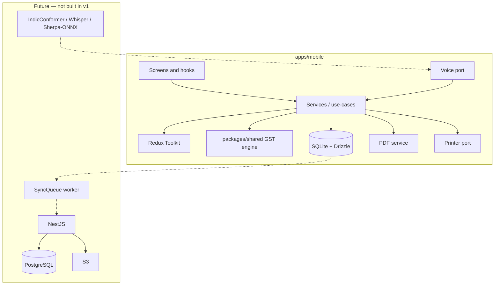

# Architecture

Offline-first GST billing for small vendors. The v1 product is a standalone React Native app. SQLite is the source of truth. The network is not on the billing path.

Related docs: [Development Roadmap](./DEVELOPMENT_ROADMAP.md) · [Data Model](./DATA_MODEL.md) · [Sync](./SYNC.md) · [ML Architecture](./ML_ARCHITECTURE.md)

## Locked v1 decisions

| Decision | Choice |
|---|---|
| Operating model | Local-first. Bill with no account. Cloud login is optional later. |
| Backend | Not in v1. NestJS / PostgreSQL / JWT are a future phase only. |
| Admin web | Out of scope. No `apps/web`. |
| Core workflow | Must work with zero network. |

Internet is not required for products, customers, vendor profile, GST calculation, invoices, PDF, or print.

## Design principles

1. Core billing never depends on the network, a backend, or cloud storage.
2. SQLite is the source of truth for persisted business data. Redux does not hold the catalog.
3. Business logic lives in services and pure modules, not screens.
4. Invoice line items store product snapshots. Live product rows may change after an invoice is finalized.
5. Finalized **paid** invoices are immutable. Unpaid finalized invoices may be replaced in place (same number) via cart edit; paid corrections remain cancel + new invoice. Credit notes are out of v1.
6. Money is integer paise. Quantity is integer milli-units. GST rates are basis points. No IEEE floats for tax totals.
7. UUIDs are generated locally so records can be created offline.
8. Every local mutation that matters for a future cloud is written in a SQLite transaction and marked `syncStatus = pending`.
9. Do not introduce an ML model unless evaluation shows a demonstrated need.
10. Keep `/ml` research separate from the production app.
11. Do not over-engineer. No unused NestJS/Prisma scaffold in v1.
12. TypeScript `strict`. Avoid unnecessary `any`.

## System context

```
                    MOBILE (v1 product)
             React Native / TypeScript
                       │
          ┌────────────┴────────────┐
          ▼                         ▼
     Application layer         Redux Toolkit
     (services / use-cases)    (UI, draft, settings)
          │
          ▼
     SQLite + Drizzle
          │
          ▼
     Offline billing
          │
          ├──► GST engine (packages/shared)
          ├──► PDF service
          └──► Printer port

     Future (not built in v1)
          SQLite ──► SyncQueue ──► NestJS ──► PostgreSQL
          Voice port ──► ASR ──► NLP ──► invoice draft
```



## v1 vs later

| Capability | v1 | Later |
|---|---|---|
| Vendor / product / customer CRUD | Local SQLite | Same + incremental sync |
| Manual invoice | Active cart in Redux; open carts in SQLite (local-only); finalize → invoice | Unchanged GST path |
| GST calculation | `packages/shared` | Backend recomputes on sync |
| PDF | pdf-lib on device | Optional S3 backup |
| Thermal print | Printer port after hardware is known | Same |
| Auth | Optional cloud login | JWT, tokens in Expo Secure Store |
| Sync | Outbox worker + NestJS when API URL set | Same |
| Voice billing | OS STT → typed extract/match (dev client) | On-device ASR only after WER |
| Thermal print | `PrinterPort` stub | ESC/POS after printer SKU |
| Admin web | Never in current scope | Only if explicitly requested |
| `apps/backend` | Present for optional backup | NestJS + Prisma + PostgreSQL |

## Monorepo

v1 creates a mobile app and shared TypeScript packages. Do not create `apps/backend` or `apps/web` until requested.

```
invoice-gst/
  apps/mobile/
  packages/types/              # Domain types
  packages/validation/         # Zod schemas
  packages/shared/             # GST engine, money helpers
  docs/
  ml/                          # Research only; no models in the app binary
  .gitignore
  .env.example
  package.json                 # pnpm workspaces
  pnpm-workspace.yaml
```

Tooling: pnpm workspaces, Node 20 LTS, TypeScript `strict`. Add Turborepo only when two or more packages have real build/test scripts.

Shared packages exist so a future NestJS app can import the same GST engine and Zod schemas. They are not an abstraction layer for its own sake.

### Mobile feature layout

```
apps/mobile/src/
  navigation/
  providers/
  features/
    dashboard/
    products/
    customers/
    vendors/
    invoices/
    gst/
    printer/
    settings/
    voice/                     # port + stub in v1
    sync/                      # schema-aware stubs; no HTTP
  database/
    schema/
    migrations/
    client/
    repositories/
  store/slices/
  services/
    pdf/
    printer/
    storage/
  components/common/
  utils/
```

Screens handle UI, user interaction, navigation, and calling hooks/services. They do not calculate GST, write invoices, generate PDFs, or talk to printers.

## State management

SQLite owns persisted business data: vendors, products, customers, invoices, payments, GST config, sequences, audit events.

Redux Toolkit owns:

- UI state (modals, selected tab, list filters)
- Active billing cart mirror (until park/finalize); open carts live in SQLite and are not synced
- Application settings
- Sync status presentation (later)
- Auth session presentation (later)

Do not load the catalog into Redux as a mirror of SQLite.

## Data and identity

- Primary keys are UUIDs generated on device.
- Soft delete via `deletedAt` where the row must remain for history or future sync.
- `syncStatus`: `pending | synced | conflict | failed`. Stays `pending` until a backend exists.
- No `serverId`. A future server uses the same client UUID as its primary key.
- Walk-in invoices are allowed: `invoices.customerId` is nullable. Persist a `customerSnapshot` on the invoice.

Schema details: [DATA_MODEL.md](./DATA_MODEL.md).

### Money conventions

| Concept | Storage | Example |
|---|---|---|
| Money | integer paise | ₹100.00 → `10000` |
| Quantity | integer milli-units | 2.5 kg → `2500` |
| GST rate | integer basis points | 18% → `1800` |

Display/formatting happens at the UI boundary. The GST engine and repositories speak integers only.

## GST engine

Location: `packages/shared`. Pure functions. No React. No I/O. Independently testable.

```ts
calculateInvoiceTotals(input: {
  lines: Array<{
    quantityMilli: number;
    unitPricePaise: number;
    gstRateBps: number;
    priceInclusive: boolean;
    lineDiscountPaise: number;
  }>;
  invoiceDiscountPaise: number;
  isInterState: boolean;
  roundingMode: 'nearest' | 'up' | 'down';
  compositionScheme: boolean;
}): InvoiceTotals
```

Rules:

- Intra-state: split GST equally into CGST + SGST.
- Inter-state: IGST only. `isInterState` when `vendor.stateCode !== customer.stateCode`.
- Walk-in / missing customer state: treat as intra-state using the vendor `stateCode`.
- Inclusive price: back-out tax from the line total.
- Exclusive price: tax on taxable amount.
- Composition scheme: no CGST/SGST/IGST split (Bill of Supply). Store the flag in v1; implement Bill of Supply layout when there is a composition vendor to test.
- A future backend must recompute totals and reject mismatches beyond 1 paise.

Invoice numbers: `{prefix}/{FY}/{seq}` e.g. `ABC/25-26/000123`. Financial year is April–March. Uniqueness is local: `(vendorId, financialYear, invoiceNumber)`.

## Invoice workflow

```
Create draft (Redux)
  → optional customer or walk-in
  → add products + quantity
  → calculateInvoiceTotals()
  → preview
  → SQLite transaction (invoice + items + sequence + payments)
  → status = finalized
  → PDF and/or print
  → sync_queue row or syncStatus = pending
```

This path must not call a network API.

Write path for local mutations: a single SQLite transaction. If `sync_queue` insert is deferred to the sync phase, still set `syncStatus = pending`.

## Module boundaries

| Module | Responsibility | Depends on | Must not depend on |
|---|---|---|---|
| `features/invoices` | Draft UI, history, details | GST engine, invoice repo, PDF/printer ports | ASR, HTTP |
| `features/products` | Catalog CRUD + aliases | Product repo, Zod | Invoice UI internals |
| `features/customers` | Customer CRUD | Customer repo, Zod | Invoice UI internals |
| `features/vendors` | Local business profile | Vendor repo | Auth |
| GST engine | Tax math | Money helpers only | React, SQLite, network |
| PDF service | `generateInvoicePDF(invoice)` | Invoice DTO, fonts | Screens |
| Printer port | `connect` / `printInvoice` / `disconnect` | ESC/POS adapter | Screens, PDF-lib |
| Voice port | `Audio \| text → InvoiceDraftItem[]` | NLP + product matcher | Invoice screens |
| Sync (later) | Outbox drain + pull | SyncQueue, API client | Invoice UI |

## PDF and printer

- `generateInvoicePDF(invoice)` is independent of invoice screens.
- Include business info, GSTIN, invoice number, date, customer snapshot, lines (HSN, qty, rate, GST), CGST/SGST or IGST, discount, total.
- Embed an Indic font (e.g. Noto Sans Malayalam). Without it, Malayalam/Tamil/Hindi will render as tofu. Check the font license before bundling.
- `printInvoice(invoice)` sits behind `PrinterPort`. Target ESC/POS for 58mm / 80mm.
- Do not choose a Bluetooth library until the hardware is identified: Bluetooth Classic, BLE, USB, or LAN. Android retail printers are often Classic, not BLE.
- Expo Go is acceptable until native printer or on-device ASR modules appear. Production runtime is Expo + `expo-dev-client`.
- React Native Vision Camera is not in v1. Barcode/SKU scan is a later product feature.

## Voice and ML boundary

Voice billing is a separate module. ASR is not coupled to invoice screens.

```
Microphone → Audio → ASR → regional text → normalize
  → extract entities → match product aliases → structured line
  → GST engine → invoice draft
```

v1 exposes the TypeScript port and a manual text stub. No model ships in the app binary. Research lives under `/ml`. See [ML_ARCHITECTURE.md](./ML_ARCHITECTURE.md).

NLP starts as deterministic rules (numbers, units, rupees, alias lookup). No LLM unless rules fail in measured evaluation.

## Future backend (not built)

When requested: NestJS + PostgreSQL + Prisma, independently deployable from mobile.

- JWT auth. Refresh tokens. Password hashing. Tokens on device go to Expo Secure Store, never SQLite.
- REST. Incremental `POST /sync/push` and `POST /sync/pull?since=`.
- Validate all input. Recompute GST. Idempotency keys on push.
- S3 for optional PDF/backup objects.

Protocol: [SYNC.md](./SYNC.md). Schema appendix: [DATA_MODEL.md](./DATA_MODEL.md).

## Error handling

Never swallow errors. Use typed errors and a thin structured logger.

| Error | Typical cause |
|---|---|
| `ValidationError` | Zod failure on product, customer, or invoice draft |
| `DatabaseError` | SQLite/Drizzle failure, migration, constraint |
| `InvoiceStateError` | Mutating a finalized invoice, invalid sequence |
| `PrinterError` | Connect/print/disconnect failure |
| `SyncError` | Later: network, conflict, auth expiry |
| `AsrError` | Later: transcription or entity extraction failure |

## Security

v1 has no JWT and no required secrets for local billing.

Still:

- Never commit `.env` files or API keys.
- Keep `.gitignore` and `.env.example` from day one so later AWS/JWT keys cannot be committed accidentally.
- Do not hardcode secrets.
- A future backend must not trust client-side GST totals.

## Testing

Test first where money can be wrong.

- GST engine: inclusive/exclusive, 0/5/12/18/28%, discounts, inter-state, composition, rounding.
- Repositories against temp SQLite.
- Invoice finalize as a single transaction.
- Sync tests only when the worker exists.
- ASR WER and entity-extraction metrics only under `/ml/evaluation`.

## Technical risks

1. Bluetooth Classic vs BLE — Expo Go will not be enough; printer SKU must be known before Phase 7.
2. Indic fonts in pdf-lib — must bundle TTF and confirm license.
3. Low-end Android + future on-device ASR — model size/RAM; keep ASR out of the binary until measured.
4. Mixed-language WER (Malayalam + English shop speech) — hardest ASR case.
5. Invoice number uniqueness — fine on one device; breaks on a second device unless FY+prefix+device or server allocation is added.
6. GST legal surface — e-invoice/IRN and e-way bill are out of v1. Composition is a stored flag, not a full Bill of Supply UI until tested.
7. Drizzle + `expo-sqlite` compatibility — pin versions known to work together.
8. Quantity precision — UI must treat 2.5 kg as `2500` milli-units.
9. Older diagrams (Next.js, Vosk, BLE-PLX) are superseded. Do not follow them.

## Open decisions (non-blocking for docs)

1. Exact thermal printer model — required before Phase 7.
2. Android-only vs iOS later — Android-first is the default (retail + USB/BT printers).
3. Monorepo tool — pnpm. Turbo optional.
4. Composition invoice UI in v1 — store the flag; Bill of Supply layout when there is a vendor to test.
5. Expo SDK version — pick current stable at scaffold time. Do not pin it in these docs.
