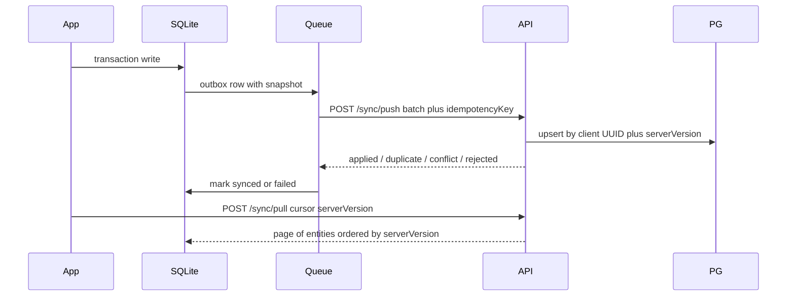

# Synchronization

Outbox protocol. The phone bills from SQLite and never calls the network while saving an invoice. PostgreSQL is the merged cloud copy. `apps/backend` implements auth, devices, `POST /sync/push`, and `POST /sync/pull`. The mobile sync worker drains `sync_queue` when `EXPO_PUBLIC_API_URL` is set.

Core billing never waits on this protocol. An account is optional.

Related docs: [Architecture](./ARCHITECTURE.md) · [Data Model](./DATA_MODEL.md) · [User guide](./USER_GUIDE.md) · [Admin guide](./ADMIN_GUIDE.md)

## Multi-device model

- Several phones can bill at once. Each signed-in phone is a `Device` row with its own refresh sessions, `lastSeenAt`, and `lastSyncAt`.
- Each device gets a one-character **series code** (`A`, `B`, … from a 32-code alphabet). Invoice numbers: `{prefix}{series}/{FY}/{seq:5}` (e.g. `INVA/25-26/00001`), at most 16 characters (GST Rule 46). Shop prefix is 1–3 characters.
- Revoked devices keep their series; codes are never reused. `DEVICE_LIMIT` when all codes are taken.
- Signing back into the **same** shop on this phone resumes sync (push outbox, then pull). Local products/customers/invoices created while signed out are uploaded; nothing is wiped.
- Phone 2 (or a different shop UUID) sign-in asks to replace local shop data when needed, then pulls and rebuilds `invoice_sequences` for its series.

## Flow

```
Local operation
  → SQLite transaction (entity + sync_queue snapshot)
  → Sync worker (when online + valid tokens)
  → POST /sync/push (batch + idempotencyKey)
  → Backend validates, recomputes GST, writes PostgreSQL, bumps serverVersion
  → Ack / conflict / rejected
  → Mark local row synced (or failed)
  → POST /sync/pull { cursor: serverVersion, limit }
  → Apply pages in SQLite (skip dirty master-data rows)
```



## Auth and devices

| Endpoint | Role |
|---|---|
| `POST /auth/register` | Email + password + device + local vendor/GST snapshot. Creates User, Vendor (client UUID), Device series `A`. |
| `POST /auth/login` | Adds/updates Device, assigns next free series. |
| `POST /auth/refresh` | Rotates refresh token; reuse of a rotated token revokes that device's sessions. |
| `POST /auth/logout` | Revokes current device sessions. |
| `GET /devices` | List shop devices (label, series, last seen/sync, current). |
| `DELETE /devices/:id` | Revoke another device and its sessions. |

Access JWT (15 min) carries `sub`, `vendorId`, `deviceId`. Tokens live in Expo Secure Store only — never SQLite.

## Sync API

### Push

Entity types: `vendor | gst_configuration | product | customer | invoice`.

- One vendor batch at a time via Postgres advisory lock so `serverVersion` order matches commit order.
- Idempotency keys unique per vendor.
- Finalized invoices are create-only; cancel is a separate operation. GST recomputed on every invoice.
- Master data: last-write-wins on `updatedAt`. Client timestamps more than 5 minutes in the future are clamped.
- Results: `applied`, `duplicate`, `conflict` (server wins; next pull brings it down), `rejected`.

### Pull

`POST /sync/pull { cursor: serverVersion, limit }` returns

`{ vendor, gstConfiguration, products, customers, invoices (items + payments), nextCursor, hasMore }`

ordered by `serverVersion`, including soft-deleted rows. Replaces the old shared timestamp cursor that could skip rows across tables.

Device `lastSyncAt` is updated after each successful push or pull.

## Mobile worker

Triggers: app open, foreground, network back, local write (debounced 5 s), every 2 minutes while open, Android background task (~15 min), exponential backoff on network/5xx (cap 30 min).

- Marks up to 100 queue rows `in_flight` (newest pending per master-data entity).
- Reclaims `in_flight` older than 10 minutes back to `pending`.
- Session expired / device revoked → sync pauses; Home banner: "Backup paused — tap to sign in. Bills on this phone are safe."

## Rules

1. Incremental only. Never replace the entire database on the wire (restore is an explicit full pull after clear).
2. Local writes use a single SQLite transaction. The outbox row is part of that transaction.
3. Client UUIDs are the server primary keys.
4. Finalized invoices are create-only on the server. Cancel is a new `operation`.
5. Master data: last-write-wins on `updatedAt`. Older client updates surface as `conflict`.
6. Deletes are soft: `deletedAt` + `operation = delete`.
7. Duplicates use `idempotencyKey` (unique per vendor).
8. The server recomputes GST and rejects a mismatch beyond 1 paise.
9. Tokens live in Expo Secure Store, never in SQLite.
10. Partial batch failure: ack succeeded items; leave the rest `pending` or `failed` with `lastError`.

## Queue row

See [DATA_MODEL.md](./DATA_MODEL.md) `sync_queue`.

| Field | Role |
|---|---|
| `entityType` | `vendor`, `customer`, `product`, `invoice`, `gst_configuration` |
| `entityId` | Client UUID |
| `operation` | `create`, `update`, `delete` |
| `payload` | JSON snapshot. Invoice payload includes items and payments |
| `idempotencyKey` | UUID, unique |
| `status` | `pending`, `in_flight`, `synced`, `failed`, `conflict` |

## Out of scope

Phone OTP, password-reset email, web admin, S3 PDF storage, e-invoice/IRN.
